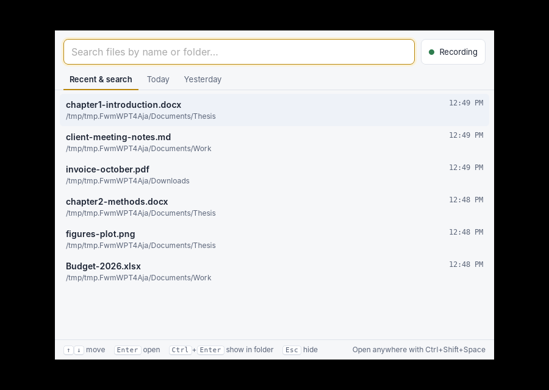
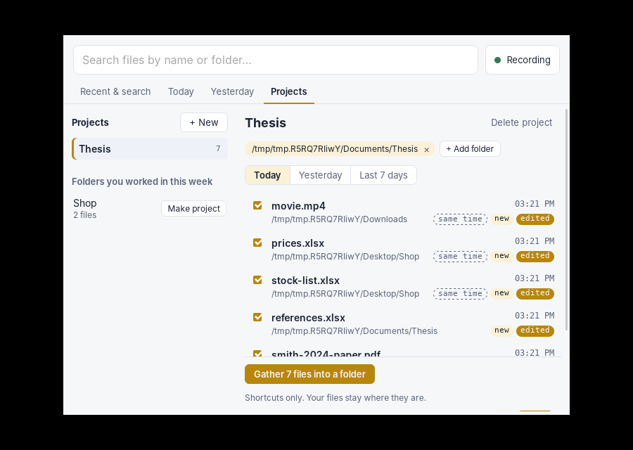
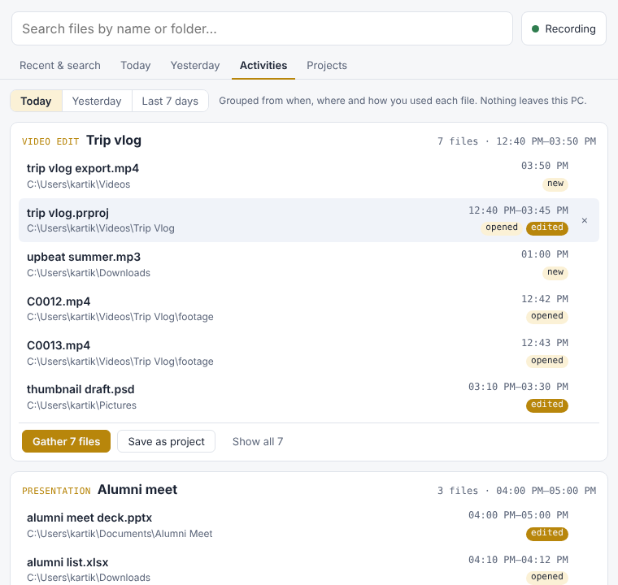
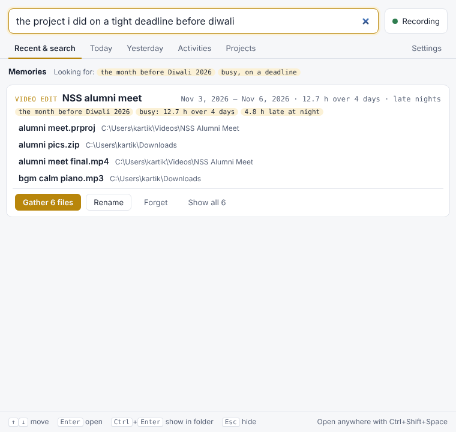
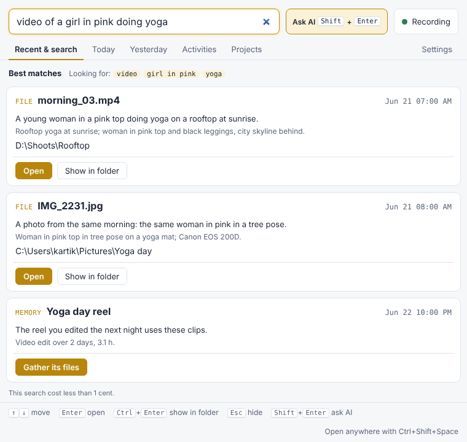
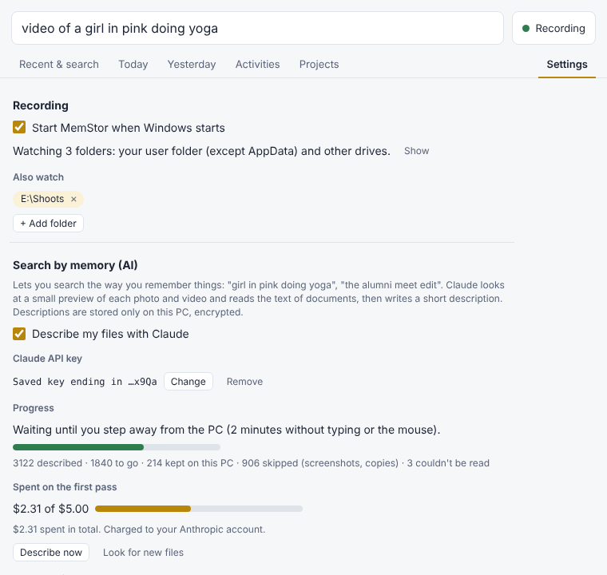
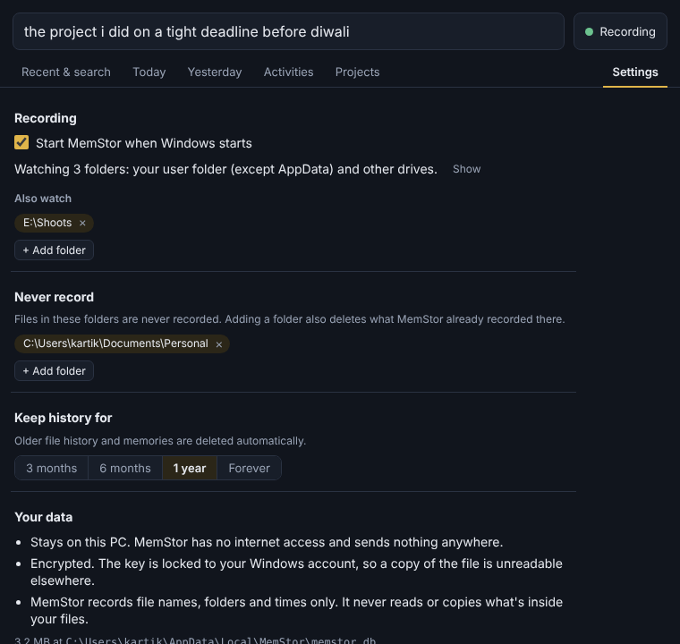

# MemStor

Find files on your computer by what you were doing, not only by what you named them.

MemStor runs quietly in the Windows tray and records which files you create, edit, rename and
open. Press **Ctrl+Shift+Space** anywhere to search that history or see what you worked on
today. Everything stays in an encrypted database on your PC. Nothing is sent anywhere unless you
turn on **Search by memory (AI)**, which is off until you add your own Claude API key.

The plan: https://claude.ai/artifact/PQbWgqCHXuf8BgrXnNueuJ



## Get it

Every push builds Windows downloads on GitHub Actions. Open the latest run under
**Actions → Build**, download `memstor-windows`, and run the `MemStor_…_x64-setup.exe` installer.

## Using the tray app (M1)

- MemStor starts hidden in the tray. **Left-click** the icon or press **Ctrl+Shift+Space** to open search.
- Type part of a file name or a folder it was in. With an empty box you see your most recent files.
- **Today** and **Yesterday** list every file you touched, with the time span and what happened.
- **Enter** opens the file, **Ctrl+Enter** shows it in Explorer, **Esc** hides the window.
- Pause or resume recording from the button in the window or the tray menu.
- Closing the window keeps MemStor running. Quit from the tray menu.
- Start it with `memstor-app.exe --show` to open the window right away.

## Projects and gather (M2)

Open the **Projects** tab:

- **+ New** names a project and points it at the folder where its files live (you can add more folders).
  Or press **Make project** on one of the *Folders you worked in this week* suggestions.
- Pick **Today**, **Yesterday** or **Last 7 days** to see every file used for the project. Files in its
  folders are listed, and so are files elsewhere (Downloads, Desktop…) used within 30 minutes of them,
  marked **same time**. Untick anything that doesn't belong.
- **Gather** makes a new folder of shortcuts in `Documents\MemStor Gathered\<project> <date>` and opens it.
  Your files are never moved or copied.



From the command line: `memstor projects`, `memstor project-add Thesis --folder D:\Uni\Thesis`,
`memstor project-files Thesis`, `memstor gather Thesis --date 2026-10-27`.

## Activities: related files found for you

No folders to set up. The **Activities** tab groups files you used together for one piece of work,
like a video edit (the editor's project file, the footage, music from Downloads, the export) or a
deck with the spreadsheet and photos it uses. Each activity can be gathered into a folder of
shortcuts or saved as a project.

MemStor works it out only from what it already records: work sessions (a pause of 20+ minutes ends
one), files in the same project folder, shared words in file names, kinds of file that go
together, files used within 5 minutes of each other, and files used together on earlier days.
Hover a file and click × if it doesn't belong; MemStor won't group those files again.



From the command line: `memstor activities --date 2026-10-27`.

## Memories: "do you remember…"

Each night MemStor saves the day's activities as **memories**: what the work was, its dates,
how much time went into it, and how much of it happened late at night. Work that continues over
several days becomes one memory. Then you can ask in plain words in the search box:

- "the project I did on a tight deadline before Diwali"
- "the edit for that organisation with alumni pics"
- "late night essay last month", "budget sheet in March"

MemStor understands times (today, last week, last month, a month, a year, "3 weeks ago", and
festivals and holidays like Diwali, Holi, Eid or Christmas with before / after / around), kinds
of work (edit, deck, sheet, photos, report…), how it felt (deadline, rush, all-nighter) and any
other words, which it matches against names of files and folders. It all runs on your PC, with no AI
service. Rename a memory to the words you'd use for it (the club, the client), or forget it.
All memories are listed under Activities → All memories.



## Search by memory (AI), optional

Search the way you remember things: "video of a girl in pink doing yoga", "the edit for the
organisation with alumni pics". Type the question and press **Shift+Enter** (or **Ask AI**).

- **Off by default.** Turn it on in Settings and paste your own Claude API key
  (console.anthropic.com). You pay Anthropic directly; MemStor has no server.
- **What is sent:** a small preview (768 px at most) of each photo, one frame of each video, and up
  to 3,000 words of each document's text, to the Claude API (Haiku 5.5). Claude writes a short
  description: people and what they wear and do, place, objects, colours, visible text, event,
  topic, who it was for.
- **What is kept:** the descriptions, only on your PC, in the encrypted database. Your files never
  leave the PC.
- **Never sent:** files in "Never record" or "Keep on this PC" folders, screenshots, duplicates,
  and documents that look like IDs, bank or card details, or passwords (Aadhaar, PAN and card
  numbers are checked on the PC first).
- **Spending limits:** $5 for the first pass over your files, then $1 a month. It stops at the
  limit and asks before spending more ("Allow $1 more"). A search costs well under a cent.
- **Runs when you are away:** describing waits until the PC has been idle for 2 minutes, unless you
  press "Describe now".
- **Searching:** Claude turns your sentence into dates, kinds of work and details; MemStor searches
  the descriptions and memories on the PC; Claude then picks the best matches and says why. Without
  a key, the local memory search above still works.
- Memories also get a one-line story ("A four-day rush to cut the alumni meet video…").
- "Delete all descriptions" removes them all; turning the feature off stops all sending.





## Privacy and settings

- Everything stays on your PC. With Search by memory off, MemStor makes no network connections.
- The database is encrypted (SQLCipher). Its key is sealed with Windows DPAPI, so only your
  Windows account on this PC can open it. A database from an older version is encrypted on first start.
- MemStor records file names, folders and times. It reads inside files only to describe them when
  Search by memory is on.
- **Settings**: start with Windows (on by default), extra folders to watch, folders never to
  record (adding one also deletes its history), keep history for 3 months / 6 months / 1 year /
  forever, and delete all history.



## What it records

| Source | Gives us | Needs admin? |
| --- | --- | --- |
| Folder watcher | files created, edited, renamed, deleted | no |
| Catch-up scan at start | files edited while MemStor was closed (first run: last 14 days) | no |
| Recent Items (`%APPDATA%\Microsoft\Windows\Recent`) | files you opened anywhere on disk | no |

**Where it looks:** every folder in your user folder (Desktop, Documents, Downloads, Pictures,
OneDrive…) except AppData and hidden tool folders like `.vscode`, plus other fixed drives (D:, E:…).
Windows, Program Files and ProgramData are skipped.

**Which files:** only everyday file types for now. The list is `TRACKED_TYPES` in
`crates/core/src/filter.rs`:

| Kind | Extensions |
| --- | --- |
| Documents | doc docx odt rtf txt md pdf epub pages tex |
| Spreadsheets | xls xlsx xlsm ods csv tsv numbers |
| Presentations | ppt pptx odp key |
| Images | jpg jpeg png gif bmp webp heic heif tif tiff svg psd ai |
| Audio | mp3 wav m4a aac flac ogg wma |
| Video | mp4 mov avi mkv webm wmv m4v |
| Archives | zip rar 7z |

It also skips Office lock files (`~$x.docx`), temp and partial downloads, `node_modules` and build
output. Saving through a temp file, as Word and Excel do, counts as one edit of the real file, and a
rename keeps the file's history. Only paths, names and times are stored, plus descriptions when
Search by memory is on.

The database is `%LOCALAPPDATA%\MemStor\memstor.db`.

## Command line

The `memstor` CLI reads and writes the same database:

```powershell
memstor watch                 # record without the tray app
memstor today
memstor day 2026-10-27
memstor search thesis chapter
memstor activities --date 2026-10-27
memstor recall the edit I made before Diwali
memstor remember              # save finished days as memories now
```

## Layout

```
crates/core      collector + database (shared)
  src/filter.rs    what counts as noise
  src/db.rs        SQLite schema, recording, day listing, full-text search
  src/recent.rs    Windows Recent Items shortcuts
  src/watch.rs     folder watcher, pause/stop control
  src/memory.rs    memories (finished pieces of work), src/recall.rs local "do you remember" search
  src/extract.rs   document text, photo dates, previews, privacy checks (all on the PC)
  src/claude.rs    Claude API calls (describe, plan a search, rerank, stories)
  src/cloud.rs     describe queue, spending limits, background worker, smart search
crates/cli       the `memstor` command
app/src-tauri    the tray app (Tauri 2): tray menu, hotkey, commands for the window
app/ui           the search window (plain HTML/CSS/JS, no build step)
```

## Build

```bash
cargo test -p memstor-core -p memstor-cli
cargo build --release -p memstor-cli

# tray app + installer (on Windows)
cd app
npx @tauri-apps/cli@2 build        # or `npx @tauri-apps/cli@2 dev` while working on it
```

On Linux the app needs `libwebkit2gtk-4.1-dev libayatana-appindicator3-dev librsvg2-dev libxdo-dev`.

## Next

- Active-window titles as an opt-in signal.
